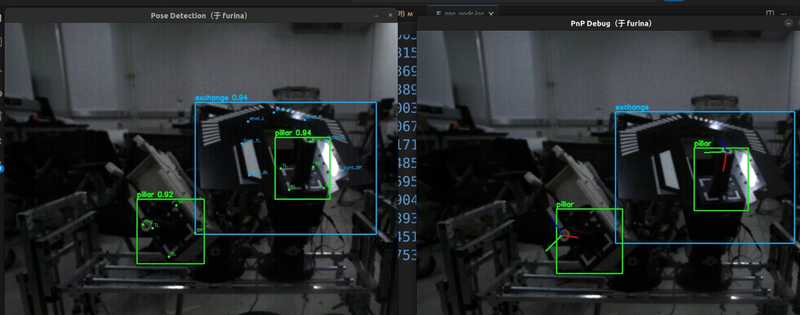
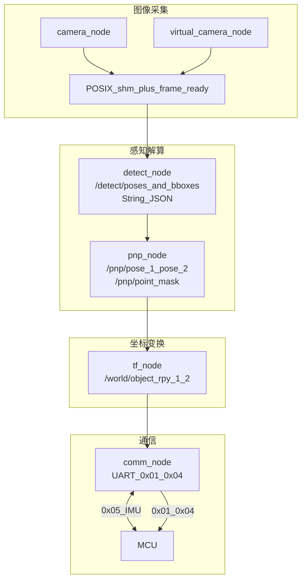

# eng — RM2026 工程视觉方案

北京理工大学 RM 战队工程机器人视觉链路：基于 ROS 2 Humble 的双目标（pillar / exchange）
检测、PnP 位姿解算、IMU 融合与世界系变换，经 UART 下发至下位机电控。

全链路约定：长度 **mm**，角度 **deg**。

维护者：梁思齐 张正 | 开源协议：[MIT](LICENSE)

---

## 1. 软件功能介绍

| 能力模块 | 说明 | 核心实现 |
| --- | --- | --- |
| 双目标检测与左右槽位 | YOLO11-Pose 检测 pillar / exchange 两类目标及 12 关键点；`DoubleDetectCheck` 完成 pillar–exchange 配对并按图像 x 分配 right / left 槽位 | [`detect_roi.py`](src/pose_detect_pkg/pose_detect_pkg/detect_roi.py)、[`double_detect.py`](src/pnp_solver_pkg/pnp_solver_pkg/double_detect.py) |
| PnP 位姿解算 | 关键点名映射至 3D 世界点，`solvePnPRansac` 解算相机系位姿；滑动窗口滤波；输出 11 点可见性 mask | [`pnp_solver.py`](src/pnp_solver_pkg/pnp_solver_pkg/pnp_solver.py)、[`keypoint_mapping.py`](src/pnp_solver_pkg/pnp_solver_pkg/keypoint_mapping.py) |
| IMU 融合与世界系变换 | raw IMU + 安装偏置生成相机旋转；OpenCV 相机系转右手系；固定平移与 40 mm 末端偏移 | [`transform.py`](src/tf_pkg/tf_pkg/transform.py)、[`tf_node.py`](src/tf_pkg/tf_pkg/tf_node.py) |
| 电控 UART 协议 | 双目标 57 B `0x01` 位姿、30 Hz `0x04` mask、MCU `0x05` IMU 回传 | [`protocol.py`](src/comm_pkg/comm_pkg/protocol.py)、[协议文档](docs/双目标链路与串口协议.md) |
| 标定 toolchain | ChArUco / 圆点板相机内参标定；SO(3) 双点安装角（IMU 偏置）交互标定 | [`charuco_calibration_pkg`](src/charuco_calibration_pkg)、[`camera_mount_calibration_pkg`](src/camera_mount_calibration_pkg) |
| 工程化配套 | POSIX 共享内存零拷贝传图；旁路 H.264 录制；Foxglove 可视化；真机 / 虚拟相机一键切换 | [`shared_frame.py`](src/shared_image_pkg/shared_image_pkg/shared_frame.py)、[`start.sh`](start.sh) |

---

## 2. 效果展示与创新优势

### 2.1 演示视频与可视化

**实验室单臂演示**（约 6 s）：

<video src="docs/assets/demo_single_arm_lab.mp4" controls width="640"></video>

**赛场双臂实战**（约 27 s）：

<video src="docs/assets/demo_dual_arm_competition.mp4" controls width="640"></video>

**双目标 PnP / 关键点实时可视化**：



### 2.2 创新点

1. **共享内存传图**：高分辨率 BGR 帧经 POSIX shm + `UInt64` 帧序号传递，避免 `sensor_msgs/Image` 走 DDS，降低延迟与 CPU 占用（[`shared_image_pkg`](src/shared_image_pkg)）。
2. **双目标单链路**：同一 detect → pnp → tf → comm 管道同时支持 right / left 双侧输出；单目标自动归入 right，无需平行造第二套检测入口。
3. **SO(3) 几何标定**：A 点确定旋转轴方向（α、β），B 点确定绕轴角 θ；Trial 锁存防止遮挡后误确认；候选偏置模型与正式 `tf_node` 完全一致（详见 [标定 README](src/camera_mount_calibration_pkg/README.md)）。
4. **算法与节点分离**：`detect_roi`、`pnp_solver`、`protocol`、`transform` 等纯算法模块可脱离 ROS 单测，节点仅负责 I/O 与调度。

### 2.3 定量指标

| 指标 | 数值 / 说明 | 来源 |
| --- | --- | --- |
| 检测输入尺寸 | 640×640 letterbox | [`detect_roi.py`](src/pose_detect_pkg/pose_detect_pkg/detect_roi.py) |
| 检测置信度阈值 | conf ≥ 0.9 | [`detect.yaml`](src/pose_detect_pkg/config/detect.yaml) |
| 检测类别 | pillar (0)、exchange (1)，12 关键点 | [`detect_roi.py`](src/pose_detect_pkg/pose_detect_pkg/detect_roi.py) |
| PnP RANSAC | 3000 iter，重投影 3.5 px，置信度 0.99 | [`pnp.yaml`](src/pnp_solver_pkg/config/pnp.yaml) |
| 关键点滑动窗口 | 3 帧，最少 4 点参与 PnP | `pnp.yaml` |
| pillar–exchange 配对 IoU | 阈值 0.3 | `pnp.yaml` |
| 位姿下发 `0x01` | 1 Hz（MCU `0x02`/`0x03` 控制启停） | [`comm.yaml`](src/comm_pkg/config/comm.yaml) |
| Mask 下发 `0x04` | 30 Hz | `comm.yaml` |
| IMU 回传 `0x05` | 约 2 Hz | [协议文档](docs/双目标链路与串口协议.md) |
| 坐标单位 | 长度 mm，角度 deg | 全链路约定 |
| 单元测试 | 10 个 test 模块，44 项用例全部通过 | `src/*/test/`，[`scripts/run_tests.sh`](scripts/run_tests.sh) |

---

## 3. 依赖与软硬件环境（A）

### 3.1 软件依赖

| 组件 | 版本 / 说明 |
| --- | --- |
| 操作系统 | Ubuntu 22.04 |
| 中间件 | ROS 2 Humble |
| 语言 | Python 3 |
| 视觉 / 数学 | OpenCV、NumPy |
| 配置 | PyYAML |
| 推理 | OpenVINO（CPU / GPU / AUTO） |
| 串口 | pyserial |
| 相机 SDK | gxipy（已内置 [`camera_pkg/gxipy`](src/camera_pkg/gxipy)，仅 `real` 模式） |
| 可选 | ffmpeg（录制）、foxglove_bridge（`ws://localhost:8765` 可视化） |

### 3.2 硬件环境

| 设备 | 说明 |
| --- | --- |
| 工控机 / PC | 推荐 x86 多核 CPU（OpenVINO CPU 推理）；可选独立 GPU |
| 工业相机 | 大恒 Galaxy 系列（[`camera_pkg`](src/camera_pkg)） |
| 下位机 | 通过 USB-UART（默认 `/dev/ttyUSB0`，115200 8N1） |
| 相机 IMU | 由下位机 MCU 经 `0x05` 回传 |
| 标定板 | ChArUco 或圆点板（[`calibration.yaml`](src/charuco_calibration_pkg/config/calibration.yaml)） |
| 机械平台 | RM2026 工程机器人（单臂 / 双臂换弹场景） |

### 3.3 外部模型权重

检测权重来自**香港科技大学（HKUST Enterprize）开源 RM2026 工程视觉模型**，不随本仓库发布：

- 权重：https://huggingface.co/hkustenterprize/RM26_engineer_exchange_model（**yolopose/v11.02**，OpenVINO FP16）
- 训练数据：https://huggingface.co/datasets/hkustenterprize/RM26_engineer_exchange
- 输入 / 输出 / 关键点格式见 [`src/assets/models/openvino_best/README.md`](src/assets/models/openvino_best/README.md)

---

## 4. 编译与安装（B）

### 4.1 系统依赖

```bash
sudo apt update
sudo apt install -y \
  ros-humble-desktop \
  python3-colcon-common-extensions \
  python3-opencv python3-numpy python3-yaml python3-serial \
  ros-humble-foxglove-bridge \
  ffmpeg
# OpenVINO 按官方文档安装，或使用 pip: pip install openvino
```

### 4.2 克隆与构建

```bash
cd BIT_RM_eng_vision

# 1. 放置检测模型（文件名勿改）
#    src/assets/models/openvino_best/best.xml
#    src/assets/models/openvino_best/best.bin

# 2. 放置相机内参（标定后生成，或从标定结果拷入）
#    src/pnp_solver_pkg/config/camera_info.yaml

# 3. virtual 模式需自备回放视频
#    src/assets/videos/<name>.mp4

colcon build
source install/setup.bash
```

### 4.3 一键启动

```bash
$EDITOR config/pipeline.yaml   # 编辑相机源与可选节点
./start.sh                    # Ctrl+C 结束整条链路
```

`config/pipeline.yaml` 主要字段：

```yaml
camera_source: real   # real=大恒相机 | virtual=视频回放
build: true           # 启动前 colcon build
foxglove: true        # ws://localhost:8765
recorder: true        # 旁路录制，崩溃不拖累核心
comm: true            # 电控串口；纯回放可关
```

各节点也可单独启动：`ros2 run <包名> <节点名>`，参数从该包 `config/*.yaml` 读取。

---

## 5. 目录结构（C）

```text
BIT_RM_eng_vision/
├── config/
│   └── pipeline.yaml              # 一键启动总配置（start.sh 读取）
├── docs/
│   ├── 双目标链路与串口协议.md    # 双目标约定与 UART 协议详解
│   └── assets/                    # README 演示视频与截图
├── scripts/
│   └── run_tests.sh               # 一键单元测试
├── start.sh                       # 主链路一键启动
├── start_mount_calibration.sh     # 安装角标定启动脚本
├── LICENSE                        # MIT 开源协议
├── README.md
├── log/                           # 运行时日志（自动生成）
├── calibration/                   # 标定输出（自动生成）
└── src/
    ├── assets/                    # 模型与视频资源包（无节点）
    │   ├── models/openvino_best/  # OpenVINO 权重放置目录
    │   └── videos/                # virtual 模式回放视频
    ├── shared_image_pkg/          # 共享内存传图库（非节点）
    ├── camera_pkg/                # 大恒相机取流 camera_node
    ├── virtual_camera_pkg/        # 视频回放 virtual_camera_node
    ├── pose_detect_pkg/           # YOLO-Pose 检测 detect_node
    ├── pnp_solver_pkg/            # PnP 解算 pnp_node
    ├── tf_pkg/                    # 世界系变换 tf_node
    ├── comm_pkg/                  # UART 通信 comm_node
    ├── recorder_pkg/              # 旁路录制 recorder_node
    ├── charuco_calibration_pkg/   # 相机内参标定
    └── camera_mount_calibration_pkg/  # SO(3) 安装角标定
```

每个 ROS 包典型结构：`config/*.yaml`（参数）、`<pkg>_pkg/`（节点与算法）、`test/`（单元测试）、`package.xml`。

---

## 6. 系统框图与数据流（D）

### 6.1 软件数据流图



关键约定：

- `_1` = right，`_2` = left；单目标固定归 right。
- `/world/object_rpy_*`：`position` = XYZ (mm)；`orientation.x/y/z` = Roll/Pitch/Yaw (deg)。
- `/pnp/point_mask`：低 16 位 right、高 16 位 left；bit0–10 为 11 点可见性，bit15 为 PnP 有效。
- 串口帧格式详见 [`docs/双目标链路与串口协议.md`](docs/双目标链路与串口协议.md)。

---

## 7. 原理与理论分析（E）

### 7.1 YOLO-Pose 关键点检测

本链路使用 HKUST 开源 YOLO11s-Pose（OpenVINO FP16），对每帧 BGR 图像做 letterbox 缩放至 640×640，转 RGB 并归一化到 [0, 1]，经 OpenVINO 推理得到候选检测行 `[x1,y1,x2,y2, score, class_id, 12×(x,y,score)]`。

两类目标：

- **pillar**（类 0）：4 角点 TL/TR/BL/BR + ring
- **exchange**（类 1）：shell_L/M/R + light 四角

检测模块采用懒加载单例，仅 `configure()` 或首次推理时读盘编译，便于无模型环境下的单元测试（[`detect_roi.py`](src/pose_detect_pkg/pose_detect_pkg/detect_roi.py)）。

### 7.2 双目标配对与左右槽位分配

`DoubleDetectCheck` 将 pillar 与 exchange 按 bbox IoU 及横向包含关系配对：

```text
pillar.TL.x > exchange.light_TL.x  且  pillar.TR.x < exchange.light_TR.x
```

槽位规则（与 [`double_detect.py`](src/pnp_solver_pkg/pnp_solver_pkg/double_detect.py) 及协议文档 §2 一致）：

- 无目标：right、left 均为空。
- 单目标（单 pillar、单 exchange 或已配对组）：固定放入 **right**。
- 双目标组：按图像中心 x 排序，x 较小为 **left**，x 较大为 **right**。
- 不做跨帧跟踪；双目标退化为单目标时剩余目标重新归入 right。

单类目标可独立 PnP：pillar 至少 4 点、exchange 至少 4 点（共 7 点中选取）。

### 7.3 PnP 与 RANSAC

将可见关键点映射至 `world_points.yaml` 中的 3D 坐标（mm，右手世界系），与 2D 像素坐标组成对应点对，调用 `cv2.solvePnPRansac`：

- 迭代 3000 次，重投影误差阈值 3.5 px，置信度 0.99
- 最少 4 个 inlier 才认为本帧有效
- 关键点经 3 帧滑动窗口均值滤波后再参与解算（[`filter.py`](src/pnp_solver_pkg/pnp_solver_pkg/filter.py)）

输出相机系下物体位姿（四元数）及 11 点可见性 bit mask。

### 7.4 坐标系变换链

PnP 给出 OpenCV 相机系位姿。经固定旋转矩阵 $R_{\mathrm{CV}\rightarrow\mathrm{RH}}$ 转至右手相机系（[`transform.py`](src/tf_pkg/tf_pkg/transform.py)）：

```text
OpenCV:  X右, Y下, Z前
右手系:  X前, Y左, Z上
```

世界系目标位置：

$$p_{\mathrm{target}}^{w} = R_{cw} \cdot (p_{rh} + R_{\mathrm{obj}}^{rh} \cdot d) + t_{cw}$$

其中 $t_{cw}$ 为相机光心在世界系的固定平移，$d = [0, 0, 40]^\top$ mm 为末端执行器偏移。

### 7.5 IMU 融合

有 IMU 时，相机旋转由 raw IMU 欧拉角与安装偏置相加后按 ZYX 顺序生成旋转矩阵：

$$R_{cw} = R_{\mathrm{ZYX}}(i_{\mathrm{roll}} + o_{\mathrm{roll}},\; i_{\mathrm{pitch}} + o_{\mathrm{pitch}},\; i_{\mathrm{yaw}} + o_{\mathrm{yaw}})$$

- $i(t)$：MCU `0x05` 实时 IMU RPY
- $o$：`imu_*_offset_deg` 安装偏置（SO(3) 标定输出）
- IMU 断流时 **hold-last**，不回落到 `camera_default_*_deg`

无 IMU 时单独使用 `camera_default_*_deg` 静态角。两套参数不可混用（[`tf.yaml`](src/tf_pkg/config/tf.yaml)）。

### 7.6 SO(3) 安装角标定（摘要）

相机安装误差可建模为修正旋转 $C \in \mathrm{SO}(3)$，轴角形式 $C = \mathrm{Exp}(\theta[\mathbf{u}]_\times)$：

- **A 阶段**：一次成功插入确定旋转轴方向 $\mathbf{u}$（球面参数 α、β，2 DOF）
- **B 阶段**：选择与 A 射线夹角 ≥ 10° 的位置，调节 θ 确定绕轴角（1 DOF）
- **Trial 锁存**：电控 `0x02` 触发后冻结 UART 实际发送帧，遮挡后仍可 Y/N 确认

完整公式、操作流程与界面说明见 [`src/camera_mount_calibration_pkg/README.md`](src/camera_mount_calibration_pkg/README.md)。

---

## 8. 软件架构与层级（F）

| 层级 | 模块 | 功能 |
|------|------|------|
| **应用层** | `camera_node`, `virtual_camera_node`, `detect_node`, `pnp_node`, `tf_node`, `comm_node`, `recorder_node`, `calibration_nodes` | 相机采集、目标检测、位姿解算、坐标广播、串口通信、数据录制、相机标定 |
| **算法层** | `detect_roi`, `pnp_solver`, `double_detect`, `transform`, `protocol`, `shared_frame`, `calibration_math` | ROI检测、PnP求解、双重检测、坐标变换、协议封装、帧管理、标定工具 |
| **基础设施层** | `ROS2 rclpy`, `OpenVINO`, `OpenCV`, `gxipy`, `pyserial` | ROS2通信、AI推理加速、图像处理、相机SDK、串口通信 |

**依赖关系：** 应用层 → 算法层 → 基础设施层

设计要点：

- **Node / Algorithm 分离**：节点负责 ROS 订阅发布与定时器；算法模块零 ROS 依赖或最小依赖，可 `python3 test/test_*.py` 单测。
- **配置驱动**：各包 `config/*.yaml` 在节点启动时读取，无需 ROS 参数服务器。
- **资源包解耦**：`assets` 包仅承载模型与视频路径，通过 `get_package_share_directory` 解析相对路径。
- **单例懒加载**：OpenVINO 模型在 `detect_roi.configure()` 时加载，避免 import 阶段强依赖权重文件。

---

## 9. 未来优化 RoadMap（G）

| 方向 | 说明 |
| --- | --- |
| 推理加速 | OpenVINO GPU / NPU 推理与 detect–pnp 多线程流水线 |
| 跨帧跟踪 | 引入轻量 ID 关联，减少双目标退化时的槽位抖动 |
| 延迟 profiling | 端到端各环节耗时统计与自适应降频策略 |
| 集成测试 | virtual 回放 + 协议 golden frame 的自动化回归 |
| 部署脚本入库 | systemd 自启动脚本纳入版本管理，替代现场生成 |
| 模型迭代 | 支持多版本权重热切换与 INT8 量化对比评估 |

---

## 10. 使用指南

### 10.1 相机内参标定

```bash
ros2 run camera_pkg camera_node &
ros2 run charuco_calibration_pkg calibration_node
# 交互：S 采集合格帧，集满后 C/Q 标定退出
# 将 calibration/<board>/<时间戳>/camera_info.yaml
# 拷入 src/pnp_solver_pkg/config/ 后重新 build
```

### 10.2 相机安装角（IMU 偏置）标定

```bash
./start_mount_calibration.sh
# 结果：calibration/camera_mount/camera_imu_offset.env
# 将 imu_*_offset_deg 拷入 src/tf_pkg/config/tf.yaml 后重启链路
```

详细原理与 A/B 阶段操作见 [标定 README](src/camera_mount_calibration_pkg/README.md)。

### 10.3 相机姿态参数勿混用

均在 `src/tf_pkg/config/tf.yaml`：

- `camera_default_*_deg`
MIT，见 [LICENSE](LICENSE)。维护者：zz、lsq：仅**无 IMU** 时的静态相机角
- `imu_*_offset_deg`：仅**有 IMU** 时与 raw IMU 相加

---

## 11. ROS 包与接口说明

| 包名 | 节点 | 主要配置 | 说明 |
| --- | --- | --- | --- |
| `shared_image_pkg` | —（库） | — | POSIX shm 传图，`FRAME_TOPIC` = `/camera/frame_ready` |
| `camera_pkg` | `camera_node` | `config/camera.yaml` | 大恒相机取流，写 shm + `CameraInfo` |
| `virtual_camera_pkg` | `virtual_camera_node` | `config/virtual_camera.yaml` | 视频回放，接口与真机一致 |
| `pose_detect_pkg` | `detect_node` | `config/detect.yaml` | OpenVINO YOLO-Pose → `/detect/poses_and_bboxes` |
| `pnp_solver_pkg` | `pnp_node` | `config/pnp.yaml` 等 | PnP → `/pnp/pose_1/2`、`/pnp/point_mask` |
| `tf_pkg` | `tf_node` | `config/tf.yaml` | 世界系 → `/world/object_rpy_1/2` |
| `comm_pkg` | `comm_node` | `config/comm.yaml` | UART `0x01/0x04` 发、`0x05` 收 |
| `recorder_pkg` | `recorder_node` | `config/recorder.yaml` | 旁路 H.264 录制（非核心） |
| `charuco_calibration_pkg` | `calibration_node` | `config/calibration.yaml` | 相机内参交互标定 |
| `camera_mount_calibration_pkg` | `mount_calibration_node` | `config/mount_calibration.yaml` | SO(3) 安装角标定（替代 tf_node） |
| `assets` | — | — | 模型与视频资源，无运行节点 |

---

### 12 开源协议

本项目采用 [MIT License](LICENSE)。各 ROS 包 `package.xml` 均声明 `<license>MIT</license>`。

---

## License

MIT，见 [LICENSE](LICENSE)。维护者：zz、lsq。
