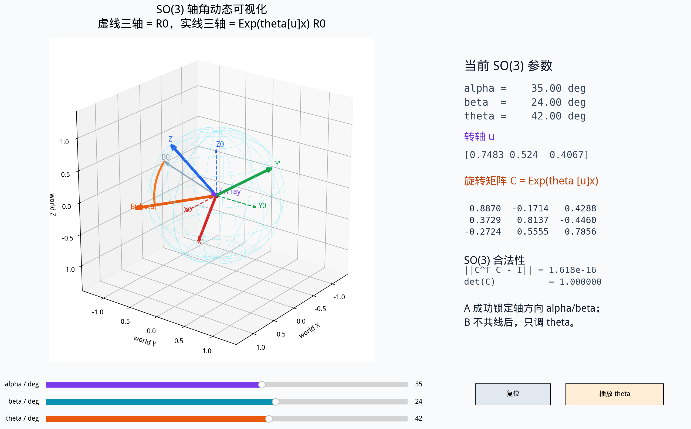
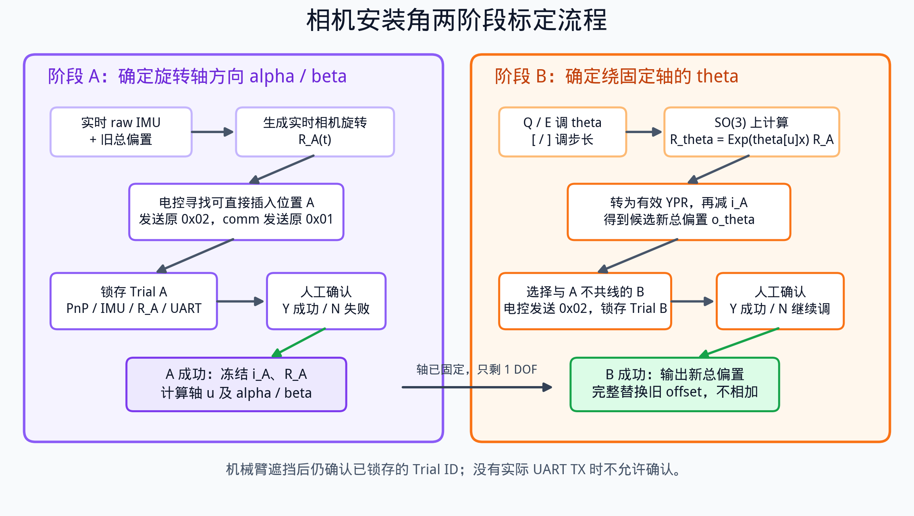

# 相机机械安装角标定：原理与操作

本文只说明两件事：

1. 为什么一次成功插入能确定旋转轴的两个参数，第二个位置能确定剩余的
   $\theta$；
2. 现场如何操作 `mount_calibration_node` 完成标定。

标定对象是相机到世界系的旋转 $R_{cw}$，最终输出为新的
`CAMERA_IMU_*_OFFSET_DEG` **总偏置**。

---

## 1. 先分清世界系、相机和教学球面

本项目中：

- `world` 是机械臂使用的固定世界坐标系；
- `camera` 原点是相机光心；
- 相机光心在世界系中的固定位置为

$$
t_{cw}=
\begin{bmatrix}
-317.4 & 0 & 422.64
\end{bmatrix}^{\mathsf T}\ \mathrm{mm};
$$

- 图中的球面 $S^2$ 只是用来表示“从相机看出去的方向”，示意球心画在
  **相机光心**，不是世界原点，也不是一个真实物体。

PnP 首先给出 OpenCV 相机系下的目标位姿。代码把它转换到右手相机系：

$$
p_{rh}=R_{\mathrm{CV}\rightarrow\mathrm{RH}}p_{cv}
$$

物体坐标系中的逆解目标点还有固定偏移

$$
d=
\begin{bmatrix}
0 & 0 & 40
\end{bmatrix}^{\mathsf T}\ \mathrm{mm}.
$$

因此，从相机光心指向机械臂实际目标点的右手相机系向量为

$$
v=p_{rh}+R_{\mathrm{obj}}^{rh}d.
$$

世界系目标位置为

$$
p_{\mathrm{target}}^{w}=R_{cw}v+t_{cw}.
$$

安装角标定修改的是 $R_{cw}$，不修改固定平移 $t_{cw}$，也不修改
$40\ \mathrm{mm}$ 末端偏移。

---

## 2. SO(3) 为什么有三个参数

$\mathrm{SO}(3)$ 是所有合法三维旋转矩阵的集合：

$$
\mathrm{SO}(3)=
\left\{
R\in\mathbb R^{3\times3}
\mid
R^{\mathsf T}R=I,\ \det(R)=1
\right\}.
$$

旋转矩阵虽然有 9 个元素，但正交约束后只有 3 个自由度。

任意三维旋转都可以写成轴角形式：

$$
R=\operatorname{Exp}\left(\theta[\mathbf u]_{\times}\right),
$$

其中：

- $\mathbf u$ 是单位转轴；
- $\theta$ 是绕该轴旋转的角度；
- $[\mathbf u]_{\times}$ 是由 $\mathbf u$ 构成的反对称矩阵。

单位轴 $\mathbf u$ 位于单位球面 $S^2$ 上。球面上的一个方向需要两个参数：

$$
\mathbf u=
\begin{bmatrix}
\cos\beta\cos\alpha\\
\cos\beta\sin\alpha\\
\sin\beta
\end{bmatrix}.
$$

因此：

$$
\underbrace{\alpha,\beta}_{\text{轴方向，2 DOF}}
+
\underbrace{\theta}_{\text{绕轴转角，1 DOF}}
=
\underbrace{3\ \mathrm{DOF}}_{\mathrm{SO}(3)}.
$$



注意：$S^2$ 只表示一根轴指向哪里，**不是完整的 SO(3)**。轴方向相同，
绕轴角 $\theta$ 不同，仍然是不同的相机姿态。

### 2.1 启动动态可视化

先构建并加载工作区：

```bash
colcon build --packages-select camera_mount_calibration_pkg
source install/setup.bash
```

启动交互窗口：

```bash
ros2 run camera_mount_calibration_pkg so3_visualization
```

窗口中可以：

- 拖动 `alpha`：改变转轴在水平面的方位；
- 拖动 `beta`：改变转轴的仰角；
- 拖动 `theta`：绕当前固定轴旋转；
- 点击“播放 theta”：自动连续旋转；
- 点击“复位”：恢复初始演示姿态。

左侧三维图中：

- 青色线框球是方向球面 $S^2$；
- 紫色箭头是转轴 $\mathbf u$，也表示 A 成功后锁定的 A 射线；
- 红、绿、蓝虚线是旋转前的三轴；
- 红、绿、蓝实线是
  $\operatorname{Exp}(\theta[\mathbf u]_\times)R_0$ 的三轴；
- 灰色 `B0` 与橙色 `B(theta)` 展示非共线 B 射线随 $\theta$ 的变化。

右侧实时显示 $\alpha,\beta,\theta$、转轴、旋转矩阵、
$\lVert C^{\mathsf T}C-I\rVert$ 和 $\det(C)$。

重新生成 README 截图和中文流程图：

```bash
MPLBACKEND=Agg ros2 run camera_mount_calibration_pkg so3_visualization \
  --save src/camera_mount_calibration_pkg/figures/so3_dynamic_preview.png \
  --flow src/camera_mount_calibration_pkg/figures/calibration_flow_zh.png \
  --no-show
```

---

## 3. 为什么 A 成功能确定两个参数

设当前旧偏置下，A Trial 实际使用的相机旋转为 $R_A$。真实正确旋转
$R_\star$ 与 $R_A$ 之间一定存在一个修正旋转：

$$
C=R_\star R_A^{\mathsf T}.
$$

把它写成轴角形式：

$$
C=\operatorname{Exp}\left(\theta[\mathbf u]_{\times}\right).
$$

设 A 点对应的相机目标向量为 $v_A$。在旧旋转下，它在世界中的方向是

$$
x_A=R_Av_A.
$$

如果 A 能够准确插入，说明旧旋转和真实旋转对 A 目标向量给出了相同结果：

$$
R_\star v_A=R_Av_A.
$$

代入 $R_\star=CR_A$：

$$
Cx_A=x_A.
$$

三维旋转中，只有位于旋转轴上的向量旋转后保持不变。因此：

$$
\mathbf u=
\operatorname{normalize}(x_A)
=
\operatorname{normalize}(R_Av_A).
$$

这就是“一次成功插入确定两个参数”的准确含义：

- A 不是直接给出 Roll 和 Pitch；
- A 确定的是修正旋转轴 $\mathbf u$ 的方向；
- 再把 $\mathbf u$ 转成球面参数，得到只读显示的 $\alpha,\beta$；
- 绕这条轴到底还需要转多少，即 $\theta$，A 本身无法确定。

这个结论要求相机固定平移和目标几何偏移基本正确。如果位置误差主要来自
$t_{cw}$ 或 $40\ \mathrm{mm}$ 偏移错误，不能把一次“碰巧插入”解释成纯旋转轴。

---

## 4. 为什么还需要 B 来确定 theta

A 成功以后，轴 $\mathbf u$ 已经固定，但绕轴旋转任意角度都不会改变轴上的
A 向量：

$$
\operatorname{Exp}
\left(\theta[\mathbf u]_{\times}\right)x_A=x_A.
$$

因此仅靠 A 无法判断 $\theta$。

选择一个与 A 射线不共线的 B 点，记其目标向量为 $v_B$。候选相机旋转为

$$
R_\theta=
\operatorname{Exp}
\left(\theta[\mathbf u]_{\times}\right)R_A.
$$

因为 $R_Av_B$ 不在旋转轴上，改变 $\theta$ 会改变 B 的世界位置和姿态。
不断调整 $\theta$，直到 B 也能插入，就确定了剩余的第三个自由度。

实际程序要求 B 射线与 A 轴的夹角至少为 $10^\circ$。过于共线时，B 对
$\theta$ 不敏感，即使“看起来差不多”，也不能可靠确定第三个参数。

---

## 5. raw IMU、旧偏置和候选新偏置如何参与

正式 `tf_node` 的计算不是“偏置旋转矩阵直接相乘”，而是先对 Euler 分量相加，
再按 ZYX 顺序生成旋转矩阵：

$$
R_{cw}
=
R_{\mathrm{ZYX}}
\left(
i_{roll}+o_{roll},
i_{pitch}+o_{pitch},
i_{yaw}+o_{yaw}
\right).
$$

其中：

- $i(t)$：电控 `0x05` 发来的实时 raw IMU RPY；
- $o_{old}$：标定开始时已有的旧总偏置；
- $o_\theta$：B 阶段由当前 $\theta$ 算出的候选新总偏置。

### 5.1 A 阶段

A 阶段 PC 不调参数，实时使用：

$$
R_A(t)=R_{\mathrm{ZYX}}\left(i(t)+o_{old}\right).
$$

当 A Trial 实际发送并确认成功时，程序冻结：

$$
i_A,\qquad R_A,\qquad v_A.
$$

然后由它们计算 $\mathbf u,\alpha,\beta$。

### 5.2 B 阶段

每次按 `Q/E` 调整 $\theta$，程序先在 SO(3) 上计算完整旋转：

$$
R_\theta=
\operatorname{Exp}
\left(\theta[\mathbf u]_{\times}\right)R_A.
$$

再把完整 $R_\theta$ 转成有效 YPR：

$$
e_\theta=\operatorname{YPR}(R_\theta).
$$

候选新总偏置为：

$$
o_\theta=
\operatorname{wrap}\left(e_\theta-i_A\right).
$$

标定节点实时发布时，仍然模拟正式 `tf_node`，使用当前 raw IMU：

$$
R_{\mathrm{used}}(t)
=
R_{\mathrm{ZYX}}\left(i(t)+o_\theta\right).
$$

所以二阶段的正确理解是：

```text
实时 raw IMU + 当前 theta 算出的候选总偏置
```

不是：

```text
raw IMU + old offset + new offset       # 错：重复叠加
把 theta 直接当作 Roll/Pitch/Yaw        # 错：theta 是绕固定轴的角
只使用冻结 R_theta，完全忽略实时 IMU    # 错：不符合正式 tf_node
```

$\alpha,\beta,\theta$ 是 SO(3) 轴角参数；界面中的 effective RPY 和候选 offset
都是由完整旋转矩阵换算出来的显示量，不是直接调节量。

A 与 B 之间相机必须保持固定。程序会监控当前 raw IMU 相对 $i_A$ 的 SO(3)
漂移；超过 $3^\circ$ 时拒绝继续确认，防止相机机械姿态已经改变。

---

## 6. Trial 为什么必须锁存

机械臂开始插入后可能遮挡相机。如果确认仍依赖实时 PnP，就无法知道确认的是
遮挡前哪一帧。

程序使用原有通信，不增加协议：

1. 目标可见，PnP right 有效；
2. 电控发送原 `0x02`；
3. `comm_node` 按原逻辑通过 `0x01` 发送世界位姿；
4. 标定节点从 `/rosout` 观察实际 UART TX；
5. 将真正发送的 XYZ/Yaw/Pitch/Roll 反查到对应 PnP、raw IMU、旋转矩阵、
   point mask 和候选偏置；
6. 创建带编号的 `Trial A-xxx` 或 `Trial B-xxx`；
7. 界面冻结该 Trial；
8. 机械动作完成后，`Y/N` 只确认屏幕上这个 Trial ID。



即使随后目标被机械臂遮挡，Trial 仍然保留。没有观察到实际、非零、可匹配的
UART TX 时，Trial 不成立，按 `Y` 也不会被接受。

---

## 7. 标定前准备

必须满足：

- 相机和 IMU 支架已经机械锁紧；
- 相机内参、PnP 尺寸和关键点映射正确；
- `t_{cw}=(-317.4,0,422.64)\ \mathrm{mm}` 基本正确；
- 机械臂末端 $40\ \mathrm{mm}$ 偏移正确；
- 场景只保留用于标定的单目标，使其稳定归到 right；
- 电控仍按原来的 `0x02 → 动作 → 0x03` 时序工作；
- A 与 B 期间不能移动相机、底盘或 IMU。

启动：

```bash
./stop_eng_real.sh
./start_mount_calibration.sh
```

如果没有 `stop_eng_real.sh`：

```bash
sudo systemctl stop eng-real.service
./start_mount_calibration.sh
```

启动后先核对界面中的：

- `raw IMU RPY` 正在更新；
- `old offset (seed only)` 是预期旧值；
- `CAMERA_DEFAULT: NOT USED`；
- 相机画面正常；
- right mask 非零且 `valid=True`；
- `comm log observed=True`。

---

## 8. 阶段 A：实际操作

1. 保持 PC 参数不动。A 阶段按 `Q/E` 不会调整任何东西。
2. 通过电控移动机械臂或选择目标位置，寻找一个可能直接插入的位置 A。
3. 确认目标清晰可见，right PnP 稳定。
4. 在电控端发送原 `0x02`。
5. 等待界面出现：

```text
TRIAL A-xxx: SENT
```

6. 机械动作完成后：
   - 插入成功：PC 按 `Y`；
   - 插入失败：PC 按 `N`，机械臂退出后继续寻找 A。
7. A 接受后，界面进入 `ADJUST_THETA_AT_B`，显示已经冻结的
   `alpha/beta`。

不要在没有 `SENT` 时按 `Y`。`Y` 表示“刚才屏幕上的这个 Trial 确实插入成功”，
不是“当前相机画面看起来正常”。

---

## 9. 阶段 B：实际操作

1. 机械臂退出 A。
2. 选择另一个与 A 射线明显不共线的位置 B。
3. 使用：
   - `Q`：减小 $\theta$；
   - `E`：增大 $\theta$；
   - `[`：减小步长；
   - `]`：增大步长；
   - `R`：无活动 Trial 时把 $\theta$ 重置为 $0^\circ$。
4. 推荐调节顺序：
   - 先用 $1^\circ$ 粗调；
   - 接近后改为 $0.1^\circ$；
   - 最后用 $0.01^\circ$ 微调。
5. 每次调整后观察：
   - `theta`；
   - `effective RPY (read-only)`；
   - `new total offset preview`；
   - `raw IMU drift from A`。
6. 目标稳定可见后，在电控端发送原 `0x02`。
7. 等待：

```text
TRIAL B-xxx: SENT
```

8. 机械动作完成后：
   - 插入失败：按 `N`，退出后继续调 $\theta$；
   - 插入成功：按 `Y`。

以下情况程序会拒绝 B：

- raw IMU 已陈旧；
- 相对 A 的 IMU 漂移超过 $3^\circ$；
- B 射线与 A 轴夹角小于 $10^\circ$；
- UART TX 没有实际发送有效 right 位姿。

---

## 10. 保存结果

B 成功并按 `Y` 后，界面进入 `REVIEW_RESULT`。

此时检查：

- `new total offset` 数值合理；
- `delta from old offset` 没有异常突变；
- SO(3) reconstruction error 接近 0；
- 接受的是正确的 A/B Trial ID。

然后依次键入大写：

```text
SAVE
```

生成：

```text
calibration/camera_mount/camera_imu_offset.env
calibration/camera_mount/camera_imu_offset_audit.json
```

`.env` 中三个数是新的**总偏置替换值**：

```text
CAMERA_IMU_ROLL_OFFSET_DEG=...
CAMERA_IMU_PITCH_OFFSET_DEG=...
CAMERA_IMU_YAW_OFFSET_DEG=...
```

不能再与旧偏置相加。

---

## 11. 无图形桌面时

```bash
CALIBRATION_UI=0 ./start_mount_calibration.sh
```

终端每次输入一行命令：

```text
q
e
[
]
y
n
SAVE
exit
```

无论图形界面还是终端界面，A/B 原理、Trial 锁存和电控通信顺序完全相同。
