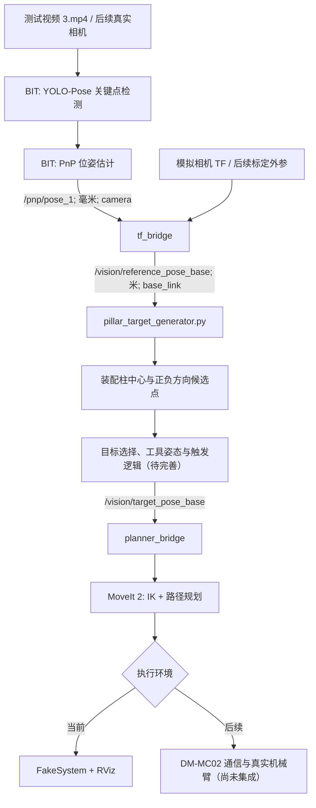

# RM2027 工程机器人视觉辅助机械臂控制系统

基于 **ROS 2 Humble、BIT 视觉定位、Panthera 机械臂模型与 MoveIt 2** 的工程机器人上位机软件集成项目。当前开发重点为兑换装置视觉定位、机械臂末端预接近位姿生成、运动规划及 FakeSystem 仿真验证。

> **项目状态：软件联调中。** 视频检测、PnP 位姿估计、坐标转换、候选接近点计算和基础运动规划已分别得到验证。**由视觉目标触发的完整 MoveIt 2 Plan → Execute 尚未完成验收。** 目前使用录制视频、模拟相机外参和 FakeSystem；不代表真实相机标定或实机自动兑矿已完成。

## 1. 系统流程



**核心原则**：视觉模块输出的是目标/特征坐标系位姿，不可直接将其四元数作为夹爪 TCP 的正确接近姿态。TCP 的正确位置与姿态需要结合装配几何关系和机械臂模型确定。

## 2. 仓库结构

> 以下树形结构按当前源码布局整理。`Panthera-HT_ROS2/` 为计划从独立工作区复制进入的机械臂工程；复制完成后纳入本仓库。`build/`、`install/`、`log/`、运行日志和缓存不纳入版本管理。

```text
rm2027/
├── README.md                              # 仓库首页与启动说明
├── .gitignore                             # 构建产物、运行日志等忽略规则
├── docs/
│   └── PROJECT_STATUS.md                 # 项目进度、问题及验收计划
├── tools/
│   └── publish_candidate_once.py          # 一次性发布实时视觉候选点用于规划验证
├── BIT_RM_eng_vision/                    # 视觉定位上游项目
│   ├── LICENSE
│   ├── README.md
│   ├── config/pipeline.yaml              # 视觉链路配置
│   ├── scripts/run_tests.sh              # 上游测试脚本
│   ├── src/
│   │   ├── assets/                       # OpenVINO 模型与视频素材
│   │   │   ├── models/openvino_best/
│   │   │   └── videos/3.mp4
│   │   ├── virtual_camera_pkg/           # 录制视频模拟相机
│   │   ├── camera_pkg/                   # 实际相机采集接口
│   │   ├── pose_detect_pkg/              # YOLO-Pose 关键点检测
│   │   ├── pnp_solver_pkg/               # PnP 位姿估计
│   │   │   └── config/world_points.yaml  # 目标三维特征点
│   │   ├── shared_image_pkg/             # 图像共享与 QoS
│   │   ├── tf_pkg/                       # 上游坐标变换工具
│   │   ├── charuco_calibration_pkg/      # 相机标定
│   │   ├── camera_mount_calibration_pkg/ # 相机安装位姿标定
│   │   ├── comm_pkg/                     # 上游通信模块
│   │   └── recorder_pkg/                 # 图像/视频录制
│   ├── start.sh
│   └── start_mount_calibration.sh
├── engineer_moveit_ws/                   # 视觉-机械臂集成工作区
│   ├── bridge_params.yaml                # 桥接参数
│   ├── demos/
│   │   ├── bit_moveit_pipeline.launch.py # 视频+检测+PnP+TF 转换启动入口
│   │   ├── pillar_target_generator.py    # 装配柱中心与候选点、Marker
│   │   ├── bit_vision_motion_demo.py      # 早期集成试验程序
│   │   ├── vision_servo_follower.py       # 历史 Servo 试验代码（非当前主线）
│   │   ├── vision_servo.launch.py         # 历史 Servo 试验启动（非当前主线）
│   │   ├── panthera_servo_overrides.yaml  # 历史 Servo 配置（非当前主线）
│   │   └── README.txt
│   └── src/
│       ├── engineer_vision_tf_bridge/
│       │   ├── src/tf_bridge.cpp          # 视觉位姿转换到 base_link
│       │   ├── src/target_pose_preview.cpp# 目标预览
│       │   └── src/planning_trigger.cpp   # 触发控制
│       └── engineer_vision_moveit_bridge/
│           ├── config/bridge.yaml        # MoveIt 桥参数
│           ├── launch/bridge.launch.py   # 启动 planner_bridge
│           ├── src/planner_bridge.cpp     # MoveGroupInterface Plan/Execute
│           └── docs/ACCEPTANCE.md        # 桥接验收记录
└── Panthera-HT_ROS2/                    # 待复制：机械臂模型与 MoveIt 2 工程
    └── src/
        ├── panthera_ht_ros_description/   # URDF/Xacro、网格、TCP
        ├── panthera_ht_config/            # MoveIt 2 配置、demo.launch.py
        ├── panthera_commander/            # 机械臂动作示例
        ├── panthera_bringup/              # 系统启动集成
        └── panthera_gazebo/               # Gazebo 相关资源
```

`dm_mc02_comm` 是独立的上下位机通信实验工程，当前位于仓库外，尚未接入视觉规划主链路。其是否并入主仓库需在完成协议验收后决定。

### 主要文件职责

| 文件/模块 | 输入 | 输出/职责 |
| --- | --- | --- |
| `virtual_camera_pkg` | `3.mp4` | 模拟图像输入 |
| `pose_detect_pkg` | 图像 | 兑换装置关键点检测 |
| `pnp_solver_pkg`、`world_points.yaml` | 关键点、相机参数和三维目标点 | 目标相对相机的位姿，`/pnp/pose_1` |
| `tf_bridge.cpp` | `/pnp/pose_1`、相机 TF | `/vision/reference_pose_base`（`base_link`，米） |
| `pillar_target_generator.py` | `/vision/reference_pose_base` | 特征面中心、±方向接近点和 RViz 标记 |
| `planning_trigger.cpp` | 视觉目标与控制指令 | 规划触发逻辑；完整集成待验证 |
| `planner_bridge.cpp` | `/vision/target_pose_base` | MoveIt 2 `arm` 规划；可选仿真执行 |
| `bridge.launch.py` | 参数与 ROS 2 环境 | 启动 `/planner_bridge` |
| `panthera_ht_ros_description` | 机械结构配置 | `base_link`、`bat_center` 等运动学模型 |
| `panthera_ht_config/demo.launch.py` | MoveIt 2 配置 | RViz、MoveGroup、FakeSystem 仿真环境 |

## 3. 运行环境与依赖

- Ubuntu 22.04；ROS 2 Humble。
- OpenVINO、BIT 视觉模型及其 Python 依赖。
- MoveIt 2、Panthera 模型与配置、`colcon`、`tf2_ros`、`rclpy`。
- 当前 Demo 不需要真实相机、下位机或电机；仅支持软件联调。
- 保留 BIT 上游许可证及原始版权说明；使用时检查模型、视频素材及 Panthera 工程各自的许可条款。

**首次从 GitHub 克隆后的准备**：`install/` 和 `build/` 不随仓库发布，三个 ROS 2 工作区必须先按依赖顺序构建。OpenVINO、模型和视频是否随仓库分发，以 `.gitignore` 和实际资产授权为准；缺少资源时需按上游项目说明补齐。

```bash
source /opt/ros/humble/setup.bash

cd ~/rm2027/BIT_RM_eng_vision
colcon build --symlink-install

cd ~/rm2027/Panthera-HT_ROS2
source ~/rm2027/BIT_RM_eng_vision/install/setup.bash
colcon build --symlink-install

cd ~/rm2027/engineer_moveit_ws
source ~/rm2027/Panthera-HT_ROS2/install/setup.bash
colcon build --symlink-install
```

> 若 MoveIt 2 或其他依赖未安装，应先按各工程的 `package.xml` 和上游说明安装。以上为构建顺序，不表示在全新环境中已完成可复现验收。复制 Panthera 到新路径后，必须重新构建并验证其启动文件是否存在绝对路径引用。

## 4. 完整软件仿真启动流程

下列顺序适用于 **已完成依赖安装、三套工作区构建并保留所需视频/模型** 的开发机。每个“终端”需要独立打开，持续运行的节点不要关闭。当前的相机外参为**仿真场景对齐参数**，不是真实相机标定值。

### 终端 1：Panthera MoveIt 2 + FakeSystem + RViz

```bash
source /opt/ros/humble/setup.bash
cd ~/rm2027/Panthera-HT_ROS2
source install/setup.bash
ros2 launch panthera_ht_config demo.launch.py
```

运行后确认 RViz 显示机械臂，`/compute_ik` 服务可用，FakeSystem 与 MoveIt 控制器已启动。**不要使用真实硬件启动文件替代 Demo。**

### 终端 2：BIT 视觉与 TF 桥接管线

```bash
source /opt/ros/humble/setup.bash
source ~/rm2027/BIT_RM_eng_vision/install/setup.bash
source ~/rm2027/Panthera-HT_ROS2/install/setup.bash
source ~/rm2027/engineer_moveit_ws/install/setup.bash
ros2 launch ~/rm2027/engineer_moveit_ws/demos/bit_moveit_pipeline.launch.py
```

该入口预期启动录制视频、检测、PnP、模拟相机 TF、`tf_bridge` 和目标预览；**静态 TF 是否随 Launch 正常启动仍是待修复事项**。确认入口可执行且视频实际播放后，再检查话题：

```bash
ros2 topic echo /pnp/pose_1 --once
ros2 topic echo /vision/reference_pose_base --once
```

如只看到 PnP 而没有 `reference_pose_base`，先检查 TF，不要直接启动运动执行。

### 终端 3：模拟相机 TF 临时补充（仅在自动 TF 缺失时）

**只有终端 2 没有发布 `base_link` → `bit_camera_optical` 变换时才运行本项；避免两个节点重复发布同一 TF。**

```bash
source /opt/ros/humble/setup.bash
ros2 run tf2_ros static_transform_publisher \
  --x -0.25 --y -0.05 --z 0.80 \
  --roll -1.57079632679 --pitch 0 --yaw -1.57079632679 \
  --frame-id base_link --child-frame-id bit_camera_optical
```

另一个终端检查：

```bash
timeout 6s ros2 run tf2_ros tf2_echo base_link bit_camera_optical
```

### 终端 4：装配柱候选位置生成

```bash
source /opt/ros/humble/setup.bash
source ~/rm2027/Panthera-HT_ROS2/install/setup.bash
source ~/rm2027/engineer_moveit_ws/install/setup.bash
cd ~/rm2027/engineer_moveit_ws
python3 demos/pillar_target_generator.py
```

候选位置：

```bash
ros2 topic echo /vision/pillar_face_center_base --once
ros2 topic echo /vision/pillar_approach_plus_base --once
ros2 topic echo /vision/pillar_approach_minus_base --once
```

在 RViz 中添加 `MarkerArray`，话题 `/vision/pillar_markers`，可显示中心与两个接近点。固定坐标系使用 `base_link`。

### 终端 5：MoveIt 2 目标规划桥

```bash
source /opt/ros/humble/setup.bash
source ~/rm2027/Panthera-HT_ROS2/install/setup.bash
source ~/rm2027/engineer_moveit_ws/install/setup.bash
ros2 launch engineer_vision_moveit_bridge bridge.launch.py
```

初次联调只规划、不执行：

```bash
ros2 param set /planner_bridge simulation_execute false
```

`planner_bridge` 订阅 `/vision/target_pose_base`。**装配柱候选点不会自动变成最终夹爪目标；目标选择、TCP 姿态修正、稳定性判断和触发流程还需进一步集成。** 在安全检查完成前，不应打开仿真执行开关，更不能接入实机。

### 终端 6：单次视觉候选点规划测试（尚待联合验收）

在上述各节点正常工作、`simulation_execute=false` 时，另开终端：

```bash
source /opt/ros/humble/setup.bash
source ~/rm2027/Panthera-HT_ROS2/install/setup.bash
source ~/rm2027/engineer_moveit_ws/install/setup.bash
cd ~/rm2027
python3 tools/publish_candidate_once.py --side plus --orientation identity
```

该脚本**实时读取** `/vision/pillar_approach_plus_base` 并**只发送一次**到 `/vision/target_pose_base`；单位四元数仅为排查运动规划问题的临时姿态。之后查看 `planner_bridge` 是否真正打印规划成功，不能将“消息成功发送”当作“轨迹规划成功”。该完整链路**尚未实测通过**。若规划成功，先检查虚拟环境、碰撞及轨迹，再单独开展 FakeSystem 执行验收。

### 单独检查各模块

```bash
ros2 node list
ros2 topic echo /pnp/pose_1 --once
ros2 topic echo /vision/reference_pose_base --once
ros2 topic echo /vision/pillar_approach_plus_base --once
ros2 service list | grep compute_ik
ros2 topic info /vision/target_pose_base
```

#### 停止

分别在运行中的终端按 `Ctrl+C`。重新启动前确认旧的 TF 发布进程已退出，避免重复发布。

## 5. 开发状态与待解决问题

| 模块 | 目前进展 |
| --- | --- |
| 视频读取、目标检测、PnP | 已验证基本数据输出 |
| PnP → `base_link` 转换 | 静态 TF 正常时成功 |
| 装配柱中心/两候选接近点 | 已发布，并在 RViz 可视化 |
| 机械臂 MoveIt 2 规划与 FakeSystem 执行 | 人工指定可达姿态下已验证 |
| 视觉候选点 IK | 两候选点采用单位四元数时已获得 IK 解，原始视觉四元数失败 |
| **视觉目标 Plan + Execute** | **尚未完成联合验收** |
| **正确 TCP 装配朝向** | **尚未确定** |
| **静态 TF 自动启动** | **曾失效，需修复 Launch** |
| 真实相机与 DM-MC02 | 尚未接入本 Demo |

具体研发记录及下一阶段验收项见 [项目状态文档](docs/PROJECT_STATUS.md)。

## 6. 开发约定

1. 当前运动主线采用 **MoveIt 2 Plan + Execute**；`vision_servo_*` 文件仅保留作历史实验记录。
2. 默认先 `Plan`，检查 IK、碰撞、轨迹和运行环境后才允许 FakeSystem `Execute`。
3. 视觉坐标单位和参考坐标系必须显式标注；PnP 位姿不可当作末端 TCP 位姿直接发送。
4. 真实硬件联调前必须完成相机外参标定、TCP 标定、机械臂模型核验、下位机协议与安全联锁验收。
5. 第三方源码应保留原始许可证、出处及必要的版权声明。
